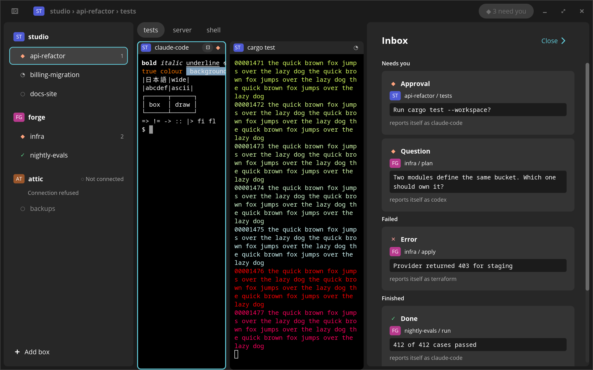

# cosmic-rex

An unofficial [Rex](https://www.superlogical.com/rex) client for the COSMIC desktop, in Rust with libcosmic. Work in progress. Not affiliated with Superlogical or System76.

## A fork, in two halves

The backend is [rex-rune](https://github.com/shuv1337/rex-rune) (MIT, Copyright 2026 shuv), used unmodified as a pinned dependency: protocol, SSH and Tailscale, reconnection, and terminal state. The frontend, typing path and box model here are new; some small pieces, such as key naming, are adapted from it. Its licence is in [docs/licenses](docs/licenses/rex-rune.txt).

## Build

Pop!_OS 24.04: Rust 1.96+, Zig 0.17.1 on `PATH`, and `sudo apt install libxkbcommon-dev`.

    cargo run --release                # your saved boxes
    cargo run --release -- --demo      # no server needed

See [docs/ARCHITECTURE.md](docs/ARCHITECTURE.md) and [docs/design](docs/design).
