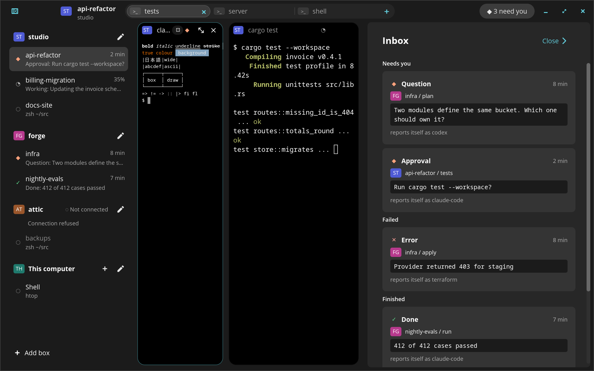
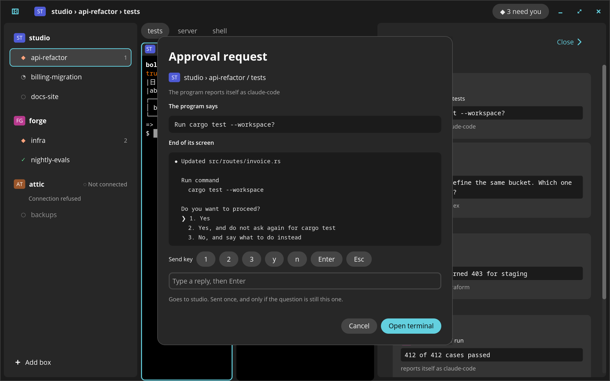

# cosmic-rex

An unofficial [Rex](https://www.superlogical.com/rex) client for the COSMIC desktop, in Rust with libcosmic. Work in progress. Not affiliated with Superlogical or System76.

## What it does

- **Boxes and sessions.** The sidebar lists each box (a Rex server) and its sessions, with what each is doing, how long it has waited and how far it has got. Boxes can be renamed or readdressed; sessions have a menu (open, rename, move, close) and can be dragged into order.
- **Tabs and splits.** Tabs sit in the title bar and have their own menu for renaming and closing. Each pane has buttons to split right or down, zoom and close, and a right-click menu with copy, paste, select all and clear. Closing asks first.
- **Sizes are shared fairly.** A pane sized by another device says so ("Elsewhere · Fit here"); typing never takes its size, and fitting it here is one click.
- **Select and copy** on this client's own copy of the screen, so nothing reaches the program. Programs that ask for the mouse get it unless Shift is held.
- **One inbox for agents.** Questions, approvals, errors and finished runs from every box, grouped by what they need, with the count in the title bar.

  

- **Answer from the inbox.** An answer sheet shows what the program said and the end of its screen, with buttons for the keys it expects or a typed reply. It is sent once, and only if the question is still the same one.

  

- **This computer's shells,** with no Rex server: choose "Use this computer" when adding a box, or enter `local` as the address. They have tabs and splits like any other box, and end when the app closes.
- **Local echo** draws typing before the server confirms it, underlined until it does.
- **Minimum contrast,** as in Ghostty: View → Minimum contrast moves text that is too close to its background toward black or white until it reaches 3:1, 4.5:1 or 7:1, keeping its hue. It is saved between runs.
- **Nerd Font icons** in prompts and status lines draw without installing anything: the app bundles Symbols Nerd Font Mono ([MIT](docs/licenses/nerd-fonts.txt), v3.4.0).

### Keys

| Keys | Does |
| --- | --- |
| Ctrl+Shift+T | New tab |
| Ctrl+Shift+D / Ctrl+Shift+E | Split right / down |
| Ctrl+Shift+Enter | Zoom or restore the pane |
| Ctrl+Shift+W | Close the pane |
| Ctrl+Shift+C / Ctrl+Shift+V | Copy / paste |
| Ctrl+Shift+S | Fit a pane sized elsewhere to this window |
| Ctrl+Shift+A | Open or close the inbox |
| Ctrl+= / Ctrl+- / Ctrl+0 | Font bigger / smaller / default (also in the View menu) |

## Built on rex-rune

The core is [rex-rune](https://github.com/shuv1337/rex-rune) (MIT, Copyright 2026 shuv): protocol, SSH and Tailscale, reconnection, and terminal state. It is used unmodified, as a git dependency at one revision, and nothing from it is copied into this repo. The frontend, typing path, local shells and box model here are new; some small pieces, such as key naming, are adapted from it. Its licence is in [docs/licenses](docs/licenses/rex-rune.txt).

Only `crates/backend` talks to rex-rune, through a small API of its own, so a change upstream is absorbed there and never reaches the UI. Its contract tests build the core's models from server JSON, so an upgrade that changes parsing, layout or status handling fails the tests instead of shipping.

To take a new rex-rune:

    scripts/update-backend.sh          # upstream's newest master
    scripts/update-backend.sh <sha>    # or a chosen revision

    scripts/update-backend.sh --check  # only say whether upstream moved

It moves every pin together (rex-rune and the `rexrs` and `ghostty-vt` it patches), prints the upstream compare link, warns if upstream changed its own pins, then runs clippy and all tests. If they fail, the old pins are put back. If they pass, review the compare link, run the live test against a throwaway session, and commit `Cargo.toml` and `Cargo.lock`. To try a patched core, point those three entries in the root `Cargo.toml` at a fork.

## Install

Pop!_OS and Ubuntu 24.04 or later: download `cosmic-rex_*_amd64.deb` from the [latest release](https://github.com/ShaneBreazeale/cosmic-rex/releases), then

    sudo apt install ./cosmic-rex_*_amd64.deb

Other distributions: the release's `cosmic-rex-*-x86_64-linux.tar.gz` holds the binary; run `cosmic-rex` from it.

There is no Flatpak. A terminal runs your shells, ssh and tailscale on the host, so a sandbox would have to be opened all the way and would protect nothing.

## Build

Pop!_OS 24.04: Rust 1.96+, `sudo apt install libxkbcommon-dev`, and Zig 0.17.1 on `PATH`. `scripts/fetch-zig.sh` puts a checked copy in `.toolchain/zig`; then `export PATH=$PWD/.toolchain/zig:$PATH`.

    cargo run --release                # your saved boxes
    cargo run --release -- --demo      # no server needed (--stress times drawing)
    cargo run --release -- --endpoint local   # this computer's shells, for this run only

The screenshots come from the demo: `cargo run --release -- --demo [--inbox | --ask] --bench 4 --screenshot shot.ppm`.

See [docs/ARCHITECTURE.md](docs/ARCHITECTURE.md) and [docs/design](docs/design).
